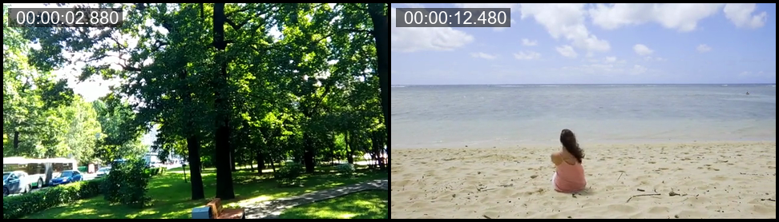
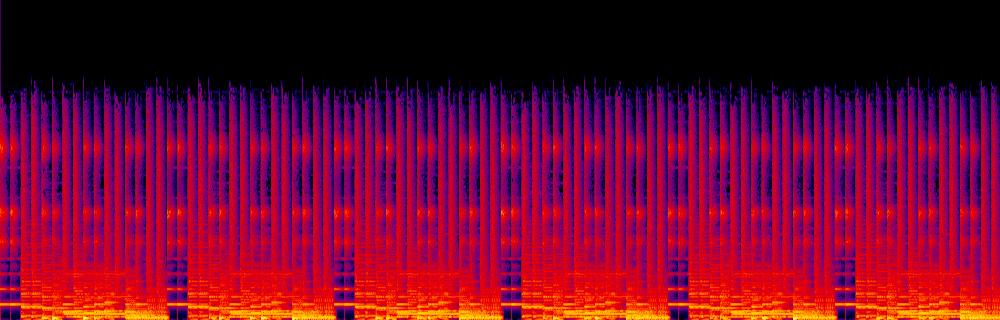
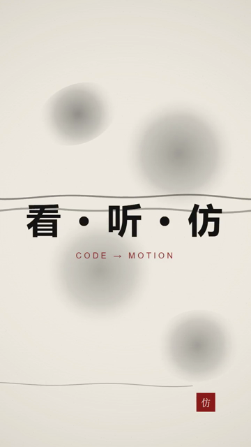
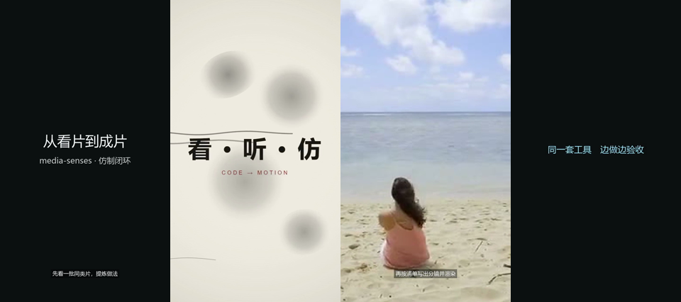
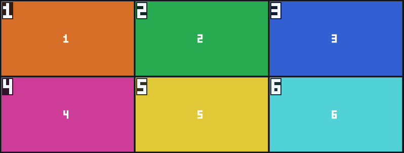
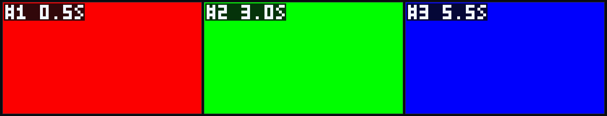
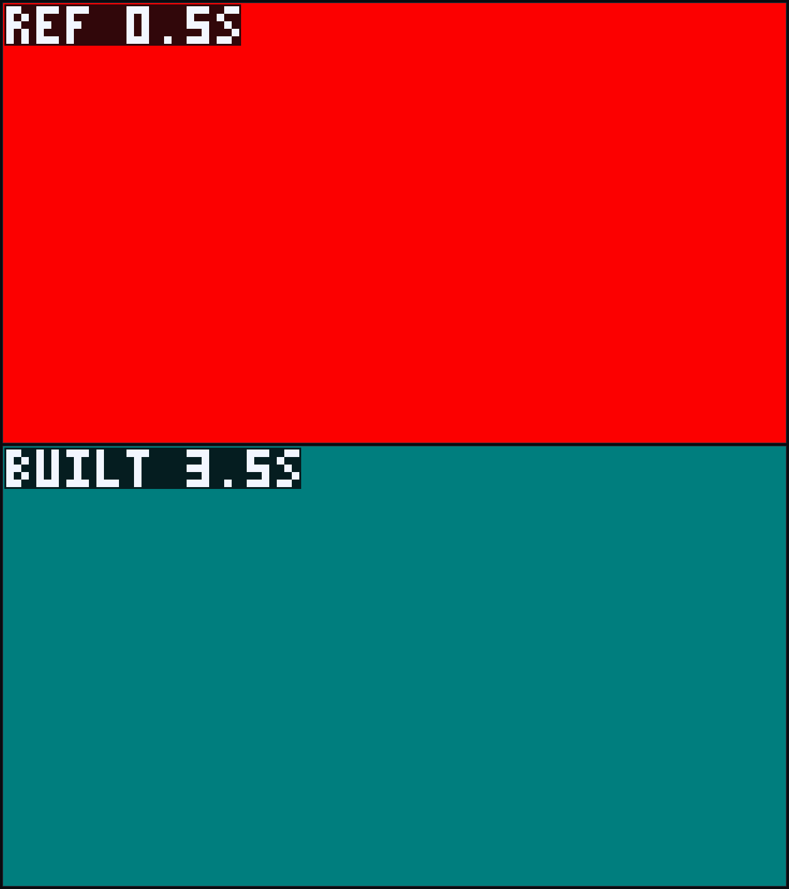

# Media Senses · 视听感知与仿制

> 给**纯文本大模型**装上眼睛、耳朵和一台剪辑机：**看懂视频、听懂音乐、看见屏幕**，
> 还能**批量学习一个品类的做法，然后自己仿制成片**。

仓库：<https://github.com/Y1410226627/media-senses>

一个 DeepSeek Harness（DSH）Host 插件，共 **13 个工具**，全部在本机用 ffmpeg + 本地 whisper 模型 +
Windows SAPI + headless 浏览器完成——**零 npm 依赖、零云 API、默认全程离线**。

- **感知**：镜头/关键帧/亮度色相字符图、逐秒曲线、BPM/调性/和弦/曲式/响度/音色、语音转写、
  制作技法（运镜/转场/调色/卡点/钩子）
- **学习与仿制**：批量语料 → 风格画像 + 仿制清单 → JSON 分镜 → 成片（转场/字幕/配乐/旁白/响度归一化）
- **图像生成**：341 种代码动画风格 → headless Edge 逐帧渲成片段，拼进成片
- **看屏幕**：按变化量选帧（切点 + 运动积分），拼成 42px token 对齐的一张图
- **视觉适配**：有视觉能力的模型自动切到「图为主」的呈现——去字符图、给格号索引、给观察任务、按需裁剪放大

---

## 1. 它解决什么问题

大模型本身只有文本通道：视频是 MP4 字节流，音乐是 PCM 波形。模型既不能解码，也无法从肉眼可读的
文件名里猜出内容。业界通常的做法是把帧丢给一个多模态模型（VLM）去「描述」，但那需要一个额外的视觉
模型和 API——不是每个本地环境都有。

本插件走另一条路：**把媒体「编译」成文本原生的感知表征**。它不假装自己拥有视觉皮层，而是尽量把
「画面长什么样、什么时候变了、说的是什么、音乐怎么走」变成模型能直接推理的数值、时间线、字符图与
结构化描述，同时把关键帧原图存到磁盘上——多模态模型（或你自己）可以随时用 `read_image` 打开核对。

### 视频 → 文本的三条通道

| 通道 | 内容 | 模型怎么用 |
|------|------|-----------|
| **时间结构** | 镜头切分（scene detection）+ 密度补帧，每个镜头的起止时间码、亮度、彩度、色调、运动量、主色板 | 建立「第几秒发生了什么」的时间轴 |
| **空间结构** | 每个镜头关键帧的 **56×22 ASCII 亮度图** + **色相字母图**（R/O/Y/G/C/B/M） + 配色比例 + 构图判断（上暗下亮、主体居中等） | 从字符画里读出布局、明暗、主体位置、有没有大片纯色/文字 |
| **语义内容** | 本地 whisper 语音转写、配乐 BPM/调性/响度、黑场/冻帧/静音/文字密集判定 | 知道视频「在讲什么」、是什么类型 |

多模态模型还可直接用 `read_image` 打开插件生成的**联系表**（缩略图网格）与**关键帧原图**。

> **图像随结果一起到达。** 如果当前模型声明了图片输入能力，插件会在同一次工具结果里直接附上联系表（视频）、
> 频谱图/波形图（音频）与帧原图——一次调用就同时拿到「结构化报告 + 真实画面」。
> 纯文本模型则完全依赖上面的 ASCII 图与数值，不受影响；磁盘上的图片路径也始终会给出，任何模型都能用
> `read_image` 或自己打开查看。

### 音乐 → 文本：真正的信号分析

音乐不是「猜」的，是用 DSP 量出来的：

- **节拍**：对数梅尔谱上的谱通量 onset 包络 → 自相关 + 对数正态先验 → BPM，并做八度折叠（[60,190] 区间），
  给出置信度与候选值（避免 60/120/240 混淆）。
- **调性**：估计调音偏差后计算色度（chroma），与 Krumhansl-Kessler 大/小调轮廓做循环相关，输出主调 +
  候选 + 置信度（对无调性/打击乐会明确说「不确定」）。
- **和弦**：24 个三和弦模板逐拍匹配 + Viterbi 平滑，输出和弦进行与变化率。
- **曲式**：色度自相似矩阵 → Foote 棋盘核 novelty → 峰值挑段，按能量/密度标注前奏/主歌/副歌/间奏/尾奏。
- **响度**：ffmpeg `ebur128` 的积分响度（LUFS）、LRA、真峰值，配 RMS/峰值/削波/静音比例。
- **音色**：谱质心、rolloff、平坦度、过零率、低/中/高频段能量占比。
- **情绪（启发式）**：唤醒度（BPM+RMS+起音密度）与效价（调式+亮度），明确标注为启发式。
- 另生成**波形图 / 频谱图 / 音级热力图 / 能量曲线图**，可 `read_image` 查看。

---

### 从「看懂」到「做出来」：仿制闭环

这个插件的目标不止于分析单条片子，而是让模型能把一个品类**学会并仿制**：

```
收集/下载         批量分析                    提炼做法                    生产                     验收
─────────      ─────────────────       ────────────────────      ───────────────────     ─────────────────
文件夹/清单  →  media_corpus        →   STYLE-PROFILE.md      →   media_build_video   →  media_watch_video
URL 列表        逐条镜头/转场/运镜/调色    + 仿制清单              （分镜→成片）           复核节奏/调色/卡点
（yt-dlp）      卡点/钩子/声音，带缓存   + RenderPlan 骨架         文字/图片/代码动画      与画像对比，差距大就改
                                                                  + TTS 旁白 + 配乐
```

- **`media_corpus`** 一次分析一整批参考视频，聚合出「这个品类是怎么做的」：镜头长度分布、硬切/渐变比例、
  运镜偏好、调色标签、BPM 区间、卡点率、标题卡/字幕出现率，并生成**仿制清单**和**可直接改写的 RenderPlan 骨架**。
- **`media_watch_video`** 对单条参考视频还会给出「制作技法」与 `media-senses.recipe/v1` **仿制配方**。
- **`media_build_video`** 是执行器：把 JSON 分镜渲染成成片（转场、标题、Ken Burns、烧字幕、配乐、旁白、响度归一化）。
- **本机代码动画技能已并入**：`media_styles` 检索 341 个风格提示词，`media_animate` 用 headless Edge 把
  `window.renderAt(t)` 的 HTML 动画逐帧渲成片段，再由 `media_build_video` 作为 `video` 场景拼进成片——
  这样「仿制」不只能拼素材，还能自己生成动态图形。
- 最后用 `media_watch_video` 回测成片，和画像的节奏/调色/卡点对比，形成闭环。
### 有视觉能力的模型：自动切到「以图为主」

插件原本是为**纯文本模型**设计的：报告里大量使用 ASCII 亮度图、色相字母图和「偏暗/高对比」这类
文字替代品。如果当前模型能看图，这些就是浪费——所以工具层会探测模型路由的 `inputModalities`，
一旦声明了 `image`，就自动切到 **vision 模式**（`mode: "blind" | "vision" | "auto"` 可手动覆盖）：

| | blind（默认 / 纯文本模型） | vision（有视觉能力的模型） |
|---|---|---|
| 画面描述 | 每镜头 15×40 亮度图 + 色相图 + 构图形容词 | **删掉**，直接给图 |
| 报告开头 | 一句话概览 | **看图说明**：每张图是什么 + 格号→时间码映射表 + 坐标约定 |
| 图片数量 | 末尾联系表 1 张 | 最多 4 张（联系表 / 时间条 / 裁剪图 / 频谱图），按 `attachments.imageLimits` 自动降档 |
| 结尾 | 「还可以问我」建议 | **观察清单**：8–10 条必须用眼睛回答的具体任务（逐格描述、比较变化、读字幕、判断景别/光线/运动） |
| 细节 | `media_frame` 给出字符图 | `media_frame` 支持 `region: "x,y,w,h"` 与 `zoom`：**裁剪原图像素再放大**，小字/纹理看得清 |

实测同一条 12 秒视频：blind 报告 4504 字符，vision 报告 2319 字符（**少 48%**），省下的预算换成更清晰的图。
配套新工具：

- **`media_frames`**：一次取多个时间点拼成带帧号的横条（首/中/尾或任意时刻）。
- **`media_compare`**：参考片 vs 仿制成片并排（上下/左右）+ 逐项数值差异（一致/接近/偏差大），
  让视觉模型回答「像不像、下一版改哪里」——仿制闭环的验收工具。

> 图片规格两档：`balanced`（默认，宽 1260px）与 `high`（宽 1596px，格子更少更大）；
> 宽度都对齐宿主的 42px patch 网格，不付补齐那一列的钱。

## 2. 安装

前置：本机有 `ffmpeg` 与 `ffprobe`（含 `signalstats`/`scdet`/`ebur128` 等滤镜；FFmpeg 8+ 最好，因为语音
转写要用内置 `whisper` 滤镜）。插件会自动在 PATH、WinGet、Scoop、Chocolatey 常见位置寻找，
也可以在配置里显式指定。

```text
plugin_manager(action="install_bundle", target="D:\\桌面\\装插件\\media-senses")
```

安装后无需重启，工具立即可用。卸载用 `plugin_manager(action="remove_bundle", target="@local/media-senses")`。

首次做语音转写时会**自动下载一次** whisper 模型（tiny 约 74MB，缓存到 `~/.dsh/media-senses/models/`）；
不想转写就把配置里的 `whisperModel` 设为 `off`，其它功能不受影响。

---

## 3. 工具集（14 个）

### `media_probe` — 先看看这是什么文件

| 参数 | 类型 | 说明 |
|------|------|------|
| `path` | string | 媒体文件路径（绝对路径或相对当前工作目录） |

返回容器/时长/视频流（分辨率、帧率、编码、旋转）/音频流/字幕轨/章节，并提示下一步该调哪个工具。
**便宜、快**，适合在深度分析前确认文件是否可分析、有没有字幕轨（字幕是理解对白的捷径）。

### `media_watch_video` — 看视频

| 参数 | 类型 | 默认 | 说明 |
|------|------|------|------|
| `path` | string | 必填 | 视频路径 |
| `start` | number | 0 | 从第几秒开始 |
| `duration` | number | 全片 | 分析时长（受配置 `videoMaxSeconds` 限制） |
| `max_keyframes` | integer | 36 | 最多关键帧/镜头明细数（上限 60） |
| `include_transcript` | boolean | true | 是否本地 whisper 转写语音 |
| `language` | string | auto | 转写语种（zh/en/auto…） |
| `output_dir` | string | 临时目录 | 联系表与关键帧的输出目录 |
| `detail` | `brief`/`full` | full | 展开多少镜头的字符图 |

产出：镜头时间线表、逐镜头的亮度图/色相图/配色/构图判断、逐秒亮度·运动·彩度曲线、配乐摘要、
语音转写、健康检查、联系表与关键帧路径。

### `media_listen_audio` — 听音乐/音频

| 参数 | 类型 | 默认 | 说明 |
|------|------|------|------|
| `path` | string | 必填 | 音频文件（也可传带音轨的视频） |
| `start` / `duration` | number | 0 / 全曲 | 分析区间 |
| `include_chords` | boolean | true | 是否识别和弦 |
| `include_transcript` | boolean | false | 是否转写人声/歌词（明显更慢） |
| `language` | string | auto | 转写语种 |
| `output_dir` | string | 临时目录 | 图像输出目录 |
| `detail` | `brief`/`full` | full | 和弦表展开程度 |

产出：BPM/拍点/置信度、调性与候选、和弦进行表、曲式分段表、响度与动态、音色与频段、人声可能性、
情绪倾向、能量曲线、波形/频谱/音级热力图。

### `media_frame` — 放大看某一刻（或一张图片）

| 参数 | 类型 | 默认 | 说明 |
|------|------|------|------|
| `path` | string | 必填 | 视频或图片路径 |
| `time` | number | 0 | 时间点（秒）；图片可省略 |
| `output_dir` | string | 临时目录 | 原图输出目录 |
| `max_width` | integer | 960 / vision 1600 | 导出原图最大宽度 |
| `region` | string | — | 只截一块：原图像素 `"x,y,w,h"`（vision 模式看细节用） |
| `zoom` | number | — | 中心放大倍数 1–8 |
| `mode` | string | auto | `blind` / `vision` 强制呈现方式 |

返回该帧的 **56×22** 亮度图与色相图（比视频报告里的更精细）、配色、对比度、边缘密度、构图判断，
并保存该帧原图。适合回答「这一秒屏幕上到底写着什么/什么颜色/主体在哪」。**也可以直接分析 png/jpg/webp/gif 图片**。

### `media_whisper` — 本地语音模型管理

| 参数 | 类型 | 说明 |
|------|------|------|
| `action` | `status`/`download`/`remove` | 查看 / 下载 / 删除 |
| `size` | `tiny`/`base`/`small` | 模型规格，默认取配置 |

`status` 会同时报告当前 ffmpeg 是否带有 `whisper` 滤镜。

---

### `media_corpus` — 批量看片，学一个品类

| 参数 | 类型 | 说明 |
|------|------|------|
| `source` | string | 文件夹、清单文件（`.txt` 每行一条 / `.json` / `.jsonl`）或单个视频 |
| `paths` | string[] | 额外的本地视频路径 |
| `urls` | string[] | 要下载的媒体链接（直链；装了 `yt-dlp` 时支持站点链接） |
| `output_dir` | string | 语料目录（缓存/分析/画像都写这里），默认 `~/.dsh/media-senses/corpus` |
| `name` | string | 画像标题 |
| `max_videos` / `max_seconds` | integer / number | 条数上限（默认 24）/ 单条分析秒数上限（默认 180） |
| `fast` | boolean | 快速模式，默认 true |
| `include_transcript` | boolean | 逐条转写（很慢），默认 false |
| `reuse_cache` | boolean | 按「路径+大小+mtime」复用，默认 true |

产出：`corpus.jsonl`、`analysis/<id>.json`、`style-profile.json`、`STYLE-PROFILE.md`，
以及报告里的**仿制清单**和 **RenderPlan 骨架**。站点下载需要 `yt-dlp`——它不随仓库分发
（22 MB 第三方二进制），按 [`bin/README.md`](bin/README.md) 一行命令放进 `bin/` 即可；
插件会依次在 `bin/`、`PATH` 与 Windows 常见安装位置里找它。直链用 ffmpeg 就够，两者都自动探测。

### `media_build_video` — 按分镜渲染成片

| 参数 | 类型 | 说明 |
|------|------|------|
| `plan` | object | RenderPlan：`output / width / height / fps / loudnessTarget / scenes[] / captions[] / audio{}` |
| `plan_path` | string | 或者给一个包含 RenderPlan 的 JSON 文件 |
| `output` | string | 覆盖输出路径 |
| `verify` | boolean | 渲染后自动用同一套感知工具复核，默认 true |
| `gate` | boolean | 渲染后跑验收门禁（见下节），默认 true |
| `lint` | boolean | 渲染前做版式体检（文字出框/标题与字幕打架/字号过小），默认 true |
| `targets` | object | 对照目标（可直接用 `style-profile.json` 里的 `reproduction.targets`） |

场景类型：`text`（中文字体/淡入/自动缩字号）、`image`（Ken Burns 推拉 / 四向平移）、`gradient`、
`color`、`video`（任意 mp4 片段，含代码动画片段）；转场 20+ 种 xfade；`audio.music` + `audio.voiceover`
（可以给文字让它用本机 TTS 念）；`loudnorm` 归一到目标 LUFS。成片**一定**有一条音频流。

图片场景的运镜：`none`、`kenburns-in`、`kenburns-out`、`pan-left`、`pan-right`、`pan-up`、`pan-down`
（`tilt-up` / `tilt-down` 与 `pan-up` / `pan-down` 等价，可以直接把 `media_watch_video` 测出来的
运镜标签回填给渲染器）。

**叠加轨**（画中画 / 角标 / 浮层，`plan.overlays[]`）：每个 `{ src, start, end, position, width, opacity, fadeIn, fadeOut }`，
`position` 九宫格（`top-left` … `bottom-right`）。叠加轨是独立于场景的**第二条轨**——场景是顺序的、占满整帧，
叠加有自己命中的时间段、只覆盖一部分画面。字幕永远画在叠加轨之上。

**变速与定格**（`video` 场景）：`rate`（0.1–10，2=两倍速、0.5=半速）改变播放速度但**不改槽位长度**；
`hold`（秒）冻结结尾帧。两者都不影响时间线，所以分镜时长仍然精确可控。

**旁白自动闪避**（`audio.duck`，默认 true；`audio.duckDb` 默认 −9）：音乐在旁白说的时候自动降下去、
说完再回来，按旁白的**实际起止时间**生成平滑包络。不加这个，一条 −20 dB 的床仍然会和 −20 dB 的人声打架，
这是「听起来业余」最常见的一个原因。

### 验收门禁：它像片，还是像 PPT

每次渲染后（`gate: true`，默认开）多跑一道门禁，**只用像素与音频测量**，给五项带阈值的判定：

| 项 | 判据 | 来源 |
|----|------|------|
| 镜头长度变化 | 镜头长变异系数 ≥ 0.25 | 等长镜头就是节拍器，哪怕每镜内部在动 |
| 静帧比例 | 静帧 ≥ 25%，且有一段 ≥ 1 s | 没有停顿的片子看得很累 |
| 变化爆发 | 1.5 s 内 ≥ 3 次大变化算一处爆发 | 全片均匀＝卡片翻页 |
| 静止空档 | 连续 ≥ 3 s 无任何变化 = 未过 | 观众会以为卡住了 |
| 音频动态 | 峰值 ≤ −3 dBFS、无削波、安静片段 ≥ 15% | 一直很响就听不出重点 |

判定同时看两个指标：**平均差异**与**变动像素占比**。只看平均差异会把稀疏运动漏掉——一条慢慢画出来的
线、一段缓慢的视差推镜，改动画面不到 2% 的像素，平均差异几乎为零，于是被误报成「完全没变化」。
加上「变动像素占比」后，这类运动能被正确识别（这条是实测里踩出来的：手绘描线和 46px 的慢推镜都被误判过）。

规则是「**只有 FAIL 才算未通过**」：`WARN` 是要你看着办并说明理由（比如一条连续运镜的作品本来
就没有爆发）。渐变色转场会让硬切检测看不见切点，这时 `cadence` 自动回退到**分镜里写的场景时长**——
量的是你剪的节奏，而不是检测器的脾气。判定会写进报告「## 验收门禁」一节，同时出现在工具返回值的
`gate_verdict` / `gate.legs` 里，可以据此改分镜重渲。

### `media_tts` — 本机中文旁白

| 参数 | 类型 | 说明 |
|------|------|------|
| `text` | string | 要朗读的文本 |
| `voice` | string | `zh`（Microsoft Huihui）/ `en`（Zira）/ 完整声部名 |
| `rate` | number | 语速 0.5–2.0 |
| `output_path` | string | wav 输出路径 |

### `media_styles` — 代码动画风格库（341 个风格）

| 参数 | 类型 | 说明 |
|------|------|------|
| `action` | `search`/`show`/`list` | 搜索气质 / 取编号的完整提示词与参考静帧 / 列系列 |
| `query` | string | 气质词或编号（「水墨」「粒子」「B3」…） |
| `id` | string | `show` 时精确指定编号（如 `Z1`） |
| `series` | string | 系列筛选：AG / M / K / Z / H / L / V / X / O / R |

素材来自本机 `~/.dsh/skills/code-animation-prompts`（可用配置 `skillDir` 覆盖），含 341 条提示词、
196 张参考静帧；`show` 会把参考静帧直接作为图片附在结果里。

`show` 还会把提示词**按节拆开**，分成「**不可改**（改了就是另一种风格：本质／材质／配色逻辑）」
与「**可替换**（换本集内容时改这些：字体／声音／可变空间／输出规格）」，并单独摘出这条风格自己
点名的禁用项。库里的提示词有三种排版（11 节的 Lemo 版、标题式的 mg 版、整段散文的 A-G/Z 版），
解析器统一归一，没有分节的会明说「整段散文，只替换内容」。

### `media_moves` — 导演词典（说法 → 数字）

| 参数 | 类型 | 说明 |
|------|------|------|
| `action` | `moves`/`transitions`/`easing`/`looks`/`antipatterns`/`rules`/`cards`/`budget`/`show` | 查什么（默认 `moves`） |
| `query` | string | `cards` 检索词（「标题」「数据」「入场」…） |
| `id` | string | `show` 精确取一项（`push-in` / `dissolve` / `anime-cel` / `camera.push-in`） |
| `category` / `energy` | string | `cards` 的类目与能量筛选 |
| `seconds` / `kind` | number / string | `budget` 的目标时长与体裁 |

「缓推一下」「用硬切」「活泼一点」这类说法在这里都有确定数值：

- **18 个运镜**：每个给时长区间、速度档、景别、`ffmpegMotion`（能直接写进分镜的就给 id，给不了的标「需代码动画」）与「为什么这样用」。
- **9 个转场**：默认时长、xfade 映射、**声音怎么处理**（J-cut 提前多久、smash 同帧换声）。
- **缓动与弹簧**：12 条命名曲线 + 按角色的选法（入场长尾 / 位移双端 / 退场加速 / 相机双端），弹簧用**阻尼比**描述「高级感」（0.7–0.85）到「卡通」（<0.3）。
- **8 套外观预设**：cinematic / anime-cel / pastel / claymation / papercut / synthwave-vhs / commercial / ink，每套给配色、材质、光位、后期与帧率/步进。
- **15 条「一眼 AI 味」**：紫青渐变底、粒子汤、镜光滥用、每切必 RGB split、处处霓虹、回弹缓动、全片慢动作……每条给表现、为什么露馅、怎么改（带数值）。
- **7 条剪辑缝规则**：切在动作最快处、两侧方向速度匹配、zoom 符号不变、主体位置差 ≤1/10 画幅、运动模糊帧内不许硬切。
- **44 张镜头配方卡**：每张有意图、运动、**参数表（参数 | 典型值 | 往哪调会怎样）**、声音、常见坑、可运行配方。第三列是关键——它说「再大就散架」而不只是「4–6 帧」。
- **时长预算**：这个时长最多画多少笔（起形+马克笔 3.9 笔/秒、按部位上色 6 笔/秒），以及五种体裁的常见时长区间。

### 可渲模板（`media_moves` 的 `templates` / `template`）

知道参数和真的渲出一条片子之间还差一大截：得记住 `renderAt(t)` 契约、保证全部由 `t` 决定、
不能有 rAF/定时器/未播种随机、图层顺序要写对。所以内置 6 个**已经能跑**的模板，
每个只暴露几个内容参数：

| 模板 | 用来做什么 | 技法 |
|------|-----------|------|
| `kinetic-type` | 一句短文案砸进观众眼里（金句/副歌/开场） | 逐字入场、过冲回落、模糊清焦、落定完全静止 |
| `mask-reveal` | 标题「被揭开」而不是淡入 | 遮罩扫过、边缘揭示、横线自画 |
| `hand-drawn-line` | 讲解类的手绘感 | stroke-dasharray 描线、线条沸腾（逐帧抖动）、纸底 |
| `data-bars` | 几组可比数字 | 错峰增长、数字与形状同步、末项强调色 |
| `ui-entrance` | 产品功能/步骤卡 | 错峰入场、ease-out 长尾、清焦、落定静止 |
| `paper-collage` | 不靠 3D 的纵深 | 多层视差、按深度分速率、纸纹暗角、近层微缩放 |

用法：`media_moves { action: "template", id: "data-bars", params: {...}, duration: 4 }` 拿到**填好内容的完整 HTML**，
直接交给 `media_animate { html: ..., duration, fps, width, height }` 渲成片段，再拼进 `media_build_video`。
每个模板都按 1920×1080 设计并自动缩放到任意输出尺寸；测试会真的把 6 个模板各渲一遍，断言帧确实在动。

### `media_animate` — 把代码动画渲成视频片段

| 参数 | 类型 | 说明 |
|------|------|------|
| `html_path` | string | 动画 HTML 文件 |
| `html` | string | 或直接给 HTML 源码 |
| `output` | string | 输出 MP4 路径 |
| `width` / `height` / `fps` / `duration` | integer / integer / integer / number | 默认 1920×1080 / 30 / 12 |
| `motion_blur` | integer | 运动模糊子帧数（1=关闭，2–16）。快运镜/甩镜要开 |
| `shutter_angle` | number | 快门角 0–360，默认 180（电影常规） |
| `mix_audio` | boolean | 把页面内 `<audio>` 混进输出，默认 true |
| `style_id` | string | 记录所用的风格编号 |

**两种页面契约都支持**，这是和以前最大的区别：

1. **`window.renderAt(t)`** — 画面完全由秒数 t 决定（最可控，推荐）。
2. **普通 HTML** — 完全不改代码也能渲：CSS `@keyframes`、WAAPI、GSAP 时间轴（`window.__timelines`）、
   声明式 clip（`data-composition-id` + `data-start`/`data-duration`/`data-track-index`）都会被
   **逐帧 seek 到 t**。渲染器检测到没有 `renderAt` 但有上述任一结构时，自动装一个通用 shim。

页面内可以写 `<audio data-start="0" data-duration="6" data-volume="0.5" src="music.wav">`，
渲染后自动 `adelay`+`amix` 混进 MP4，不用再绕 `media_build_video`。

渲染器用本机 headless Edge + CDP 逐帧截图（1×1 flush 防黑帧、强制视口裁剪、
冻结时钟、逐帧重置随机种子），ffmpeg 编码，**不需要安装 Playwright**。实测 720×1280@24fps 6 秒
约 155 秒（约 1 秒/帧），建议先渲短片段预览。

渲染**前**会先静态扫一遍 HTML 源码，把 `Date.now()` / `performance.now()` / `requestAnimationFrame` /
定时器这类非确定性调用**点名到行列号**写进警告——确定性注入层通常能兜住，但一旦成片出现跳帧或
循环不动，第一个要查的就是这里，而十分钟渲染完之后才发现太亏。
### `media_see` — 看屏幕（吸收自 dsh-see-now）

| 参数 | 类型 | 说明 |
|------|------|------|
| `action` | `peek`/`watch`/`status` | peek 截一张当下画面 / watch 采几秒并按变化挑帧 / status 查采集能力 |
| `seconds` | number | watch 采样时长（默认 6，最多 20） |
| `fps` | integer | 采样帧率（默认 12） |
| `quality` | `low`/`standard`/`high` | 长边约 800 / 1050 / 1260 |
| `region` | string | 只看一块：物理像素 `"x,y,w,h"`，或 `"off"` |
| `max_frames` | integer | watch 最多保留几帧（默认 6，最多 12） |

`peek` 返回当前屏幕截图（内嵌）+ 亮度/色相字符图 + 构图判断；`watch` 的流程是
**采集 → 变化打分 → 只保留「画面真的变了」的帧（切点尖峰 / 持续运动积分 / 兜底）→ 拼成一张
token 对齐的拼图**，并给出每帧时间、变化分与原因。Windows 用 `gdigrab`（必要时退 `ddagrab`）；
`allowScreenCapture: false` 可整体关掉。
### `media_frames` — 一次看多个时间点

| 参数 | 类型 | 默认 | 说明 |
|------|------|------|------|
| `path` | string | 必填 | 视频或图片 |
| `times` | number[] | 首/中/尾 3 点 | 最多 6 个时间点（秒） |
| `width` | integer | vision 档位（1260） | 拼图宽度 |

返回一张带帧号与时间码的横条（平均 ~190 token）。比逐次调 `media_frame` 少几次往返，
用来回答「这几秒画面怎么变的」。

### `media_compare` — 参考 vs 成片

| 参数 | 类型 | 默认 | 说明 |
|------|------|------|------|
| `reference` | string | 必填 | 参考片路径 |
| `produced` | string | 必填 | 仿制成片路径 |
| `ref_time` / `built_time` | number | 各取 50% | 取帧时间点 |
| `layout` | string | stack | `stack`（上参考下成片）/ `side`（左右） |
| `include_metrics` | boolean | true | 是否跑逐项数值对比 |
| `include_continuity` | boolean | true | 是否判定镜头承接（像不像 PPT） |
| `rubric` | boolean | false | 是否附 7 维评分卡空白表供自评 |

会分析两边、给出 11 项差异（时长/镜头数/平均镜头长/切点率/亮度/彩度/BPM/调性/硬切占比/卡点率/调色）
与总体判定（一致/接近/部分一致/偏差大），并把对比图交给视觉模型判断。**这是仿制闭环的验收步骤**。

另有两块**不占那 11 行**的独立信号：

- **镜头承接（carry score）**：回答「每个切点有没有把东西带过去」。在切点前后取帧、把画面切成 12×9 区块
  做位移搜索，判为**携带**（有东西活下来且移动 ≥2% 对角线或缩放 ≥10%）/ **锚定**（唯一活下来的东西很大且没动）/
  **裸切**（什么都没活下来＝换张图贴上来）。得分 <0.5 判「像 PPT」，<0.7 提醒。这个信号能抓住数值全对、
  但读起来像幻灯片的情况——而那正是 LLM 仿制最常见的失败。已知盲区会一并列出（连续世界边界天然少、
  320px 上暗底细节会误读、±8px 搜索上限≈2.2% 对角线）。
- **评分卡**（`rubric: true`）：7 维（风格还原度/内容与叙事/运动质量/排版与版式/完成度与质感/声音与卡点/技术正确性），
  每维 1–10 分并给锚点。评分**强制要求证据**：每条必须带时间码或帧号、且改法里必须有数字，否则整份评分被拒——
  「整体不错」这种无证据评价进不来。

## 4. 配置

在插件面板（或 `cordis.patch.yml`）里可改：

| 键 | 默认 | 说明 |
|----|------|------|
| `ffmpegPath` | `''` | 指定 ffmpeg.exe；留空自动探测 |
| `ffprobePath` | `''` | 指定 ffprobe.exe；留空自动探测 |
| `whisperModel` | `tiny` | `tiny`/`base`/`small`/`off` |
| `modelDir` | `''` | 模型与转写缓存目录，默认 `~/.dsh/media-senses` |
| `asrMaxSeconds` | 240 | 单次转写最长音频秒数（控制耗时） |
| `videoMaxSeconds` | 1800 | 视频分析最长秒数 |
| `audioMaxSeconds` | 900 | 音频分析最长秒数 |
| `maxKeyframes` | 36 | 默认关键帧数 |
| `outputDir` | `''` | 默认产物目录；留空写系统临时目录 |
| `detail` | `full` | 默认展开程度 |
| `skillDir` | `''` | 代码动画风格库目录，默认 `~/.dsh/skills/code-animation-prompts` |
| `browserPath` | `''` | headless 渲染用的浏览器（默认自动找 Edge/Chrome） |
| `animateMaxSeconds` | 60 | 单次代码动画渲染的最长时长 |
| `corpusDir` | `''` | 语料默认目录，留空用 `~/.dsh/media-senses/corpus` |
| `allowScreenCapture` | `true` | 是否允许 `media_see` 抓屏 |
| `screenQuality` | `low` | `media_see` 默认档位（low≈800px / standard / high） |
| `visionMode` | `auto` | `auto` 按模型能力自动切换；`blind`/`vision` 强制 |
| `visionImageProfile` | `balanced` | 图像档位：`balanced`（1260px）/ `high`（1596px） |
| `visionMaxImages` | 4 | 单次结果最多内嵌几张图 |

---

## 5. 工作原理（为什么这样做）

```
                ┌────────────── media_watch_video ──────────────┐
 视频文件 ──┬──▶ ffprobe 元数据                                  │
            │    ├─ 遥测一次过：scale=160,signalstats,scdet ──▶ 每帧亮度/彩度/色相/运动
            │    ├─ 切点一次过：select=gt(scene,0.3) ─────────▶ 镜头切点 + 密度补帧
            │    ├─ 每镜头抽 1 帧 ──▶ JPEG + 56×22 rgb ──▶ ASCII 亮度图/色相图/配色/构图
            │    ├─ 健康检查：freezedetect / blackdetect / silencedetect
            │    └─ 联系表：tile 拼网格 PNG
            └──▶ analyzeAudio（音轨）──▶ BPM/调性/响度/情绪
                                   └──▶ whisper 滤镜 ──▶ 语音转写
                                            ↓
                              中文结构化感知报告（render.js）

 音频文件 ──▶ ffmpeg 解码 22050Hz 单声道 f32 ──▶ 自研 DSP（FFT/onset/chroma/SSM）
             ├─ ebur128 ──▶ LUFS/LRA/真峰值
             └─ showspectrumpic / showwavespic / png.js ──▶ 图像
```

设计约束：

- **零依赖**：不用 npm 包，Node 原生 API + ffmpeg 子进程。FFT、色度、自相关、自相似矩阵都是
  `lib/dsp.js` 里手写的（约 60 行 radix-2 FFT）。
- **Windows 盘符坑**：filtergraph 里不能出现 `C:`（冒号是选项分隔符），所以所有 ffmpeg 调用都在
  私有工作目录下用**相对路径**运行，模型文件与工作目录做成兄弟目录。
- **不猜**：所有指标都从信号算出来，且带置信度；算不出来就返回 `null` 并在报告里说「不确定」，
  而不是编一个看起来像真的结论。情绪、人声、文字密集这类推断明确标注为「启发式」。
- **降级优先**：没有音轨、1 秒片段、纯色静帧、静音文件都返回带 `warnings` 的报告，不抛错。

### 变化量选帧（吸收自 dsh-see-now）

镜头检测（scene detection）擅长「硬切」，但录屏、幻灯片、一镜到底的运镜几乎没有切点。所以
`media_watch_video` 还会跑一遍**变化量分析**（`lib/change.js`，参数与判据来自
[dsh-see-now](https://github.com/SAOS-3624/dsh-see-now)，Apache-2.0，见 [THIRD-PARTY.md](THIRD-PARTY.md)）：

- 一次 ffmpeg 解码到 **64×36** RGB 网格，逐对帧算 **0–255 的变化分**（加权 HSV 差，色相比明度权重高）。
- **切点（尖峰）**：`分数 ≥ 12` 且 `> 2.5×相邻帧` 且距上一刀 `≥ 0.4s` —— 抓「画面一下子换了」。
- **积分**：分数不高但持续累加，攒够 `4 分 × fps × 3 秒` 就记一帧 —— 抓缓慢运镜、滚动网页。
- **兜底**：长时间没动静时按秒数补一帧，保证静止画面也有基准。

报告里会多一节「画面变化」：平均分/P95、硬切时间点、按信息量挑出的建议细看时刻（含原因），
配一条变化曲线。对**录屏类素材**，这比只看切点靠谱得多。

同一套「多帧拼一张图」的思路还带来一个成本优化：`media_see` 的拼图把画布宽度取 **42 的倍数**
（798 / 1050 / 1260，而不是 800 / 1064 / 1280），并对齐宿主的 patch 网格
（14px patch → 42px 格，token ≈ `行数 × (列数 + 1) + 2`）。这是整条链路里零代价的省 token 点。
### 文件结构

```
media-senses/
├── index.js            # 插件外壳：5 个工具注册、参数解析、转写编排
├── cordis.patch.yml    # 插入插件行
├── lib/
│   ├── ffmpeg.js       # 二进制探测、ffprobe、遥测解析、临时目录、时间码
│   ├── video.js        # 视频引擎：镜头/关键帧/ASCII/联系表/健康检查
│   ├── audio.js        # 音频引擎：BPM/调性/和弦/曲式/响度/音色/情绪
│   ├── dsp.js          # 纯函数 DSP：FFT、mel、chroma、自相关、novelty
│   ├── frame.js        # 单帧分析（media_frame）
│   ├── asr.js          # whisper 模型下载 + 本地转写
│   ├── png.js          # 零依赖 PNG 编码器 + 折线图/热力图
│   ├── render.js       # 中文感知报告渲染（模型看到的就是它）
│   ├── craft.js        # 制作技法：运镜/转场/调色/卡点/钩子 + 仿制配方
│   ├── corpus.js       # 批量语料分析（缓存、并发、corpus.jsonl）
│   ├── profile.js      # 风格聚合：画像 + 仿制清单 + RenderPlan 骨架
│   ├── ingest.js       # URL 下载（yt-dlp / ffmpeg 直链）
│   ├── build.js        # 合成引擎：分镜 → xfade/字幕/混音/loudnorm
│   ├── tts.js          # Windows SAPI 中文旁白
│   ├── htmlrender.js   # headless Edge + CDP 逐帧渲代码动画
│   ├── styles.js       # code-animation-prompts 风格库检索
│   ├── change.js       # 变化量打分：切点尖峰 + 运动积分（吸收 dsh-see-now）
│   ├── screen.js       # 屏幕采集 + token 对齐拼图（吸收 dsh-see-now）
│   ├── vision.js       # 视觉适配：能力探测、图片预算、尺寸夹取
│   ├── montage.js      # 时间条 / 对比图拼装 + 参考 vs 成片差异度量
│   ├── render-vision.js # 多帧 / 对比报告渲染
│   └── render-v2.js    # v2 报告渲染（技法/画像/合成结果/风格库）
├── bin/README.md       # yt-dlp 获取方式（二进制不入库）
├── locale/{en,zh}.json # 插件面板标题与描述
├── icon.svg
└── test/               # 各引擎测试 + 冒烟测试 + 夹具合成
```

---

## 6. 局限（请诚实地当参考）

1. **它不真的「看见」语义**。ASCII 亮度图/色相图能传达布局、明暗、色彩、文字块位置与运动，
   但读不出「这是一只猫」。要真正的语义描述，请把生成的 `contact sheet` / 关键帧交给多模态模型
   （`read_image`）或另配 VLM。插件已把这两个产物都准备好。
2. 字幕/文字识别只做「文字密集」的启发式判断，不做 OCR（不引 tesseract）。
3. BPM 的八度、3/4 与 6/8 拍、调性游移、无调性音乐都可能判错——报告里给了候选与置信度，别当真理。
4. 和弦识别是三和弦模板匹配，对七和弦、转位、加音只能给近似。
5. whisper tiny 的英文错字不少，中文/方言更明显；正式场合建议 `whisperModel: base`（约 141MB）。
   另外 whisper 在长静音尾部会「幻觉」出短句（业界通病），报告里会标注转写可能有错字。
6. 视频分析默认只看前 30 分钟、关键帧上限 60；超长视频请用 `start`/`duration` 分段。
7. **代码动画渲染很慢**：headless 逐帧截图约 0.1–1 秒/帧（取决于分辨率与画面复杂度），
   12 秒 1080p 片段可能要好几分钟。先渲 2–3 秒小样确认视觉，再渲全片。
8. `media_animate` 用 `file://` 打开页面（技能规范如此），页面里 `fetch()` 本地 JSON 会被 CORS 拦；
   用 `<script src>`、ES module、`` 或在 HTML 里内联数据。
9. 批量爬取的**版权与站点条款由使用者负责**；插件只提供下载与本地分析能力，不做规避。
   没有 `yt-dlp` 支持的站点，请自行准备文件后交给 `media_corpus` 的目录模式。
10. 仿制的本质是「统计规律 + 模板填槽」：它能复刻节奏、画幅、调色倾向、卡点、包装方式，
    但**不会凭空生成实拍素材**——画面素材仍需你提供，或用 `media_animate` 生成图形动画。

---

## 7. 参考与致谢（思路来源）

这块拼图是站在这些开源工作上的：

| 项目 | 借了什么 |
|------|----------|
| [FFmpeg](https://github.com/FFmpeg/FFmpeg) | 全部解码；`signalstats` / `scdet` / `freezedetect` / `blackdetect` / `ebur128` / `showspectrumpic` 等滤镜；FFmpeg 8+ 内置 `whisper` 滤镜做本地 ASR |
| [whisper.cpp](https://github.com/ggml-org/whisper.cpp) | ggml 模型格式与 whisper 模型权重（插件只下载权重，推理在 ffmpeg 内） |
| [PySceneDetect](https://github.com/Breakthrough/PySceneDetect) | 内容检测的自适应思路：`score/邻域均值 ≥ 3.0 且 score ≥ 15` 抑制镜头晃动误判 |
| [librosa](https://github.com/librosa/librosa) | onset 包络、自相关 tempo、色度、自相似矩阵/Foote novelty 的算法参考 |
| [Essentia](https://essentia.upf.edu/) | 描述符字段组织的参考（bpm、key、loudness_ebu128 等） |
| [claude-real-video](https://github.com/HUANGCHIHHUNGLeo/claude-real-video) | 「场景切点 + 密度补帧 + 去重 + 联系表 + MANIFEST」的多模态喂帧架构 |
| [vidmcp](https://github.com/ethnn-b/vidmcp) | MCP 视频工具的参数设计与按 token 预算限制帧数的经验 |
| [ASCIIEval](https://arxiv.org/abs/2410.01733) | 验证了「小尺寸 ASCII 图能被 LLM 有一定程度地读懂」，因此字符图保持小而密 |
| [MCP 规范](https://modelcontextprotocol.io/) | 工具结果可携带图像块的设计，本插件用「存图 + 路径」实现等价效果 |
| [HyperFrames](https://github.com/heygen-com/hyperframes) | HTML→视频的工程化经验：`beginFrame` 已在 Chromium 147+ 移除、必须走截图路径；1×1 flush 防黑帧、PNG 不能用 optimizeForSpeed、并行用多进程而非多标签页 |
| [chrome-remote-interface](https://github.com/cyrus-and/chrome-remote-interface) | 极简 CDP 客户端的结构（id→promise、会话路由），本插件的渲染器按同样思路用 Node 全局 WebSocket 手写 |
| [Remotion](https://github.com/remotion-dev/remotion) / [Motion Canvas](https://github.com/motion-canvas/motion-canvas) | 「代码即视频」的工程范式与逐帧导出流程 |
| [editly](https://github.com/mifi/editly) | JSON 时间线 → ffmpeg 参数构建器 的思路 |
| [dsh-see-now](https://github.com/SAOS-3624/dsh-see-now) | 变化量选帧（64×36 HSV 变化分、尖峰/积分/兜底三条件）、多帧拼一张图、**42px token 对齐**与 
ows×(cols+1)+2 估算——分别落在 lib/change.js / lib/screen.js / media_see；详见 [THIRD-PARTY.md](THIRD-PARTY.md) |
| [code-animation-prompts](https://github.com/) 技能 | 本机 `~/.dsh/skills` 里的 341 个风格提示词 + `renderAt(t)` 渲染契约（已并入 media_styles/media_animate） |

---

## 8. 真实素材演示

`demo/media/` 里放了三段真实素材（来自 samplelib 的公开示例片，仅用于演示）：

| 素材 | 内容 |
|------|------|
| `trailer.mp4` | 19 秒 · 两个真实镜头（公园树林 → 海边沙滩）＋ 两段 flite 旁白 |
| `narrated.mp4` | 5.7 秒 · 公园慢摇 ＋ 一段旁白 |
| `real-music-15s.mp3` | 19 秒真实音乐 |

```text
node demo/run-demo.mjs
```

实测输出（`demo/output/`）：

**视频** `media_watch_video` → 2 个镜头、切换率 3.1 次/分，自动区分出
`0:00.000–0:05.760 绿·偏暗` 与 `0:05.760–0:19.160 蓝·偏亮`，配色 `#122913 31%` / `#b3b6b6 70%`，
旁白被本地 whisper 转写为 “A quiet park full of tall green trees.” / “A woman sits alone on a bright beach …”，
耗时 9.2 秒（含 19 秒语音转写）。
生成的 `sheet.png` 联系表带时间码水印，把两个镜头并排放在一起——**模型一次调用就同时拿到结构化报告和真实画面**：



**音乐** `media_listen_audio` → BPM 100.3（置信 0.74，4/4，32 拍）、C 大调、14 段和弦进行、
3 段曲式、LUFS -19.4 / 峰值 -3.0 dBFS，并生成频谱图（能直接看出鼓点与贝斯线）：



完整报告：[`demo/output/02-watch-trailer.md`](demo/output/02-watch-trailer.md) ·
[`demo/output/04-listen-real-music.md`](demo/output/04-listen-real-music.md) ·
[`demo/output/05-frame-trailer.md`](demo/output/05-frame-trailer.md)

> 安装后如果要让最新的代码改动生效（本插件是 `link:` 安装），重启一次 DSH 桌面端即可；
> 工具本身在安装完成时已经可以调用。

---

### 闭环演示：从参考素材到成片

```text
node demo/run-demo.mjs          # 单条感知（01–05 号报告）
```

闭环部分用工具本身跑通（详见 `test/e2e-v2.mjs`）：

1. **学**：`media_corpus` 分析 `demo/media` 5 条真实素材 → 7.4 秒得到风格画像
   [`STYLE-PROFILE.md`](demo/output/corpus/STYLE-PROFILE.md)、仿制清单与 RenderPlan 骨架；
   再次运行命中缓存（`skipped=5`）。
2. **取风格**：`media_styles` 搜索「水墨」→ `show Z1` 拿到 1613 字提示词与参考静帧。
3. **造画面**：按提示词写 `demo/animation/ink.html`（实现 `window.renderAt(t)`），
   `media_animate` 渲成 720×1280@24fps 6 秒片段（144 帧，155 秒）：

   

4. **合成**：`media_build_video` 把「文字卡 + 代码动画片段 + 参考素材静帧（Ken Burns）+ 尾卡」
   拼成 11.6 秒竖屏成片，带 2 条烧字幕、中文 TTS 旁白、背景音乐、EBU R128 归一化（9.7 秒渲完）：

   

   完整报告：[`06-replica-demo.md`](demo/output/06-replica-demo.md)
5. **验收**：同一支 `media_watch_video` 回测成片，得到镜头数/亮度/调色标签/卡点率，报告里会和
   `targets` 对照，并解释「分镜 4 个场景、感知只统计到 1 个镜头」是因为用了渐变转场（硬切检测不计渐变）。

> 成片与代码动画片段都在 `demo/output/`：`replica-demo.mp4`、`ink-animation.mp4`。

### 看屏幕演示（吸收 dsh-see-now）

`media_see` 直接抓本机桌面：`peek` 一秒内返回当前画面 + 亮度/色相字符图；`watch` 采几秒，
只保留「画面真的变了」的帧，拼成一张 **798×334、约 162 token** 的拼图：



- 采集：`gdigrab`（本机实测一次截图 **329–341 ms**，3072×1920 桌面缩到 800 宽；上图是合成帧示例，真实采集形状相同）
- 选帧：变化分低于 12 的静止画面**一帧都不留**（只出兜底帧），切窗口/滚页面才留帧
- 成本：宽度取 42 的倍数（798 而不是 800），token ≈ `行数 × (列数 + 1) + 2`；
  6 帧 low 档实测 **162 token**，比固定 462 高的画布（222 token）省约 27%
- `media_watch_video` 也接了同一套变化量分析：报告里多一节「画面变化」，
  列出硬切点与「按信息量值得细看」的时间点（录屏/幻灯片尤其有用）

### 视觉模式演示：时间条与对比图

`media_frames` 一次取首/中/尾三帧，烧上帧号与时间码（1260×241，约 188 token）：



`media_compare` 把参考片与仿制成片上下并排，附 11 项数值判定（1260×1420，约 1056 token）：



盲模型看到这两张图的文字说明与数值表；视觉模型直接看图 + 用「格号/时间码」引用，
并用 `media_frame` 的 `region`/`zoom` 放大任何看不清的局部。
## 9. 验证

```text
node test/shell-smoke.mjs        # 外壳：二进制探测、ffprobe、单帧分析、PNG、whisper 转写      9 项
node test/audio-engine.test.mjs  # 音频引擎（120BPM / C大调 合成夹具，23 DSP + 32 集成）       55 项
node test/video-engine.test.mjs  # 视频引擎（3 场景 合成夹具 + 退化用例）                      23 项
node test/craft-engine.test.mjs  # 制作技法：运镜/转场/调色/卡点分位/配方                      19 项
node test/build-engine.test.mjs  # 合成引擎：分镜→成片、叠加轨、变速定格、闪避、TTS、响度      35 项
node test/corpus.test.mjs        # 批量语料：展开/缓存/画像/骨架                              18 项
node test/change.test.mjs        # 变化量打分与选帧：切点/积分/兜底（吸收 dsh-see-now）       19 项
node test/screen.test.mjs        # 屏幕采集 + token 对齐拼图（含真实截屏）                   23 项
node test/htmlrender.test.mjs    # 代码动画渲染：CDP、确定性、源码扫描、黑帧检测、降级          17 项
node test/anim-runtime.test.mjs  # 运行时平权：CSS/WAAPI seek、声明式时间轴、运动模糊、页内音频  20 项
node test/templates.test.mjs     # 6 个模板逐个真渲一遍，断言帧在动、参数生效                 19 项
node test/gate.test.mjs          # 验收门禁：节奏/静帧/爆发/空档/音频五条腿 + 稀疏运动            16 项
node test/styles-guidance.test.mjs # 风格提示词分节：不可改/可替换/禁用项（含真实库）         13 项
node test/vocabulary.test.mjs    # 词汇库：12 曲线 + 弹簧、18 运镜、9 转场、8 外观、15 反模式    30 项
node test/shots-lint.test.mjs    # 镜头卡库、版式体检、评分卡（含无证据拒绝）                 39 项
node test/continuity.test.mjs    # 镜头承接判定 + 区域停留（合成夹具现场生成）                22 项
node test/moves-tool.test.mjs    # media_moves 的 9 个 action 与 JSON 安全性                  15 项
node test/e2e.mjs                # v1 端到端：真实调用感知工具                                9 项
node test/vision.test.mjs        # 视觉适配：能力探测、图片预算、裁剪、多帧/对比报告         19 项
node test/montage.test.mjs       # 时间条/对比图拼装与参考 vs 成片差异度量                    19 项
node test/vision-render.test.mjs # blind/vision 双模式报告（含 blind 逐字节回归）              31 项
node test/e2e-v2.mjs             # 全链路：学→取风格→造画面→合成→回测→看屏幕                16 项
                                   —— 合计 504 项断言，全部通过
```

夹具是**合成**的，因此有 ground truth 可比：音频夹具是 120 BPM、C 大调、4/4、24 秒的鼓+贝斯+旋律
（实测 120.0 BPM / 置信 0.99；C major / 置信 0.99；前奏/主歌/副歌三段）；视频夹具是 12 秒、
3 个视觉显著不同的场景（实测 3 个镜头，亮度 0.195 → 0.380 → 0.490 单调递增，与设计一致）。

## 10. 环境与许可

| 依赖 | 必需？ | 说明 |
|------|--------|------|
| Node.js ≥ 20 | 必需 | 插件本身零 npm 依赖 |
| FFmpeg 8+（`ffmpeg` + `ffprobe`） | 必需 | 建议 full build：`signalstats`/`scdet`/`ebur128`/`xfade`/`zoompan`/`whisper` 等滤镜；插件会自动探测，也可用配置指定 |
| Microsoft Edge 或 Chrome | 需要 `media_animate` 时才要 | headless 逐帧渲染代码动画 |
| Windows SAPI 中文声部 | 需要中文旁白时才要 | Windows 自带「Microsoft Huihui Desktop」 |
| whisper ggml 模型（74 MB 起） | 需要语音转写时才要 | 首次自动下载到 `~/.dsh/media-senses/models/`，可用配置关闭 |
| yt-dlp | 需要站点批量下载时才要 | 见 [`bin/README.md`](bin/README.md) |

代码以 **MIT** 发布（见 [LICENSE](LICENSE)）。其中吸收的第三方算法与素材来源（dsh-see-now Apache-2.0、
code-animation-prompts 技能、FFmpeg、whisper.cpp、PySceneDetect、librosa、HyperFrames 等）逐项列在
[THIRD-PARTY.md](THIRD-PARTY.md)；`demo/media/` 的示例片来源见 [demo/media/README.md](demo/media/README.md)。

> 使用提醒：批量下载、分析与仿制视频时，请自行确认素材的版权与所在站点的服务条款；屏幕采集只在
> 本机进行、不联网上传，可用 `allowScreenCapture: false` 关闭。


